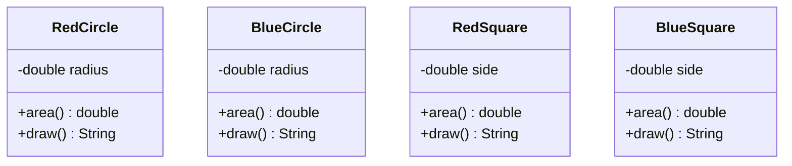
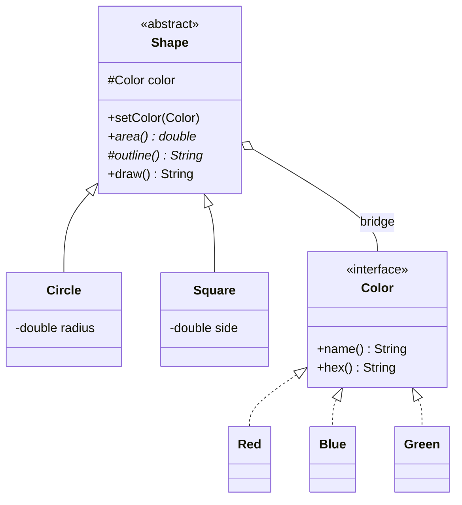

# Bridge — Shapes

**Week 5 · Structural**

## Intent
Decouple an abstraction from its implementation so the two can vary independently, connecting them by composition instead of inheritance.

## The problem (`main`)
- Four classes `RedCircle`, `BlueCircle`, `RedSquare`, `BlueSquare` – one per (shape × color).
- The circle's `area()` is copy-pasted into both circles, the square's into both squares; each color's name and hex code is copy-pasted into every shape of that color.
- The classes share no common type, so you cannot keep "any shape" in a list, and a shape cannot change color – you must create an object of a different class.
- Adding `Green` means 2 new classes; adding a `Triangle` means one per color (n × m growth).

## The solution (`solution/bridge-shapes`)
- `Shape` (Abstraction) holds a `Color` reference – the bridge – and builds the `draw()` text once.
- `Circle` and `Square` (Refined Abstractions) contain only their own geometry.
- `Color` (Implementor) is the interface the shapes talk to.
- `Red`, `Blue`, `Green` (Concrete Implementors) – a new color is one class, a new shape is one class (n + m).
- Because the color is a field, `setColor()` can swap it at runtime.

## Before

## After

## Compare
[problem/bridge-shapes...solution/bridge-shapes](https://github.com/vamekh/ug-design-patterns-2025/compare/problem/bridge-shapes...solution/bridge-shapes)

## Discussion
- Two independent dimensions (what the shape is × how it is filled) are the signal for Bridge; the same idea appears as shapes × renderers (vector/raster) or UI × platform.
- `draw()` in `Shape` is a small Template Method: the shape supplies `outline()`, the color supplies the fill.
- Cost: an extra interface and indirection; overkill if there is only one color.
- Compare with the [Remote & device](https://github.com/vamekh/ug-design-patterns-2025/blob/solution/bridge-remote-device/docs/bridge-remote-device.md) example: same structure, different domain.
