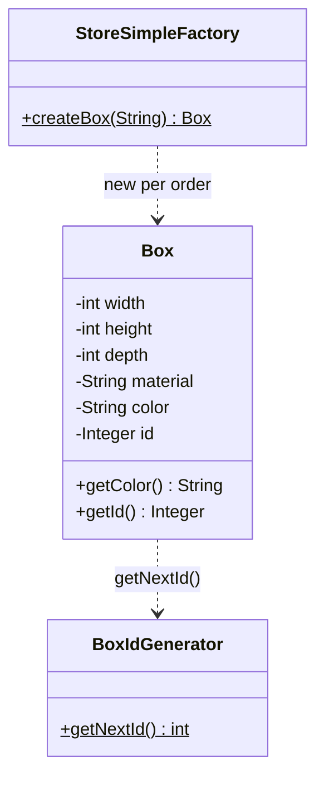
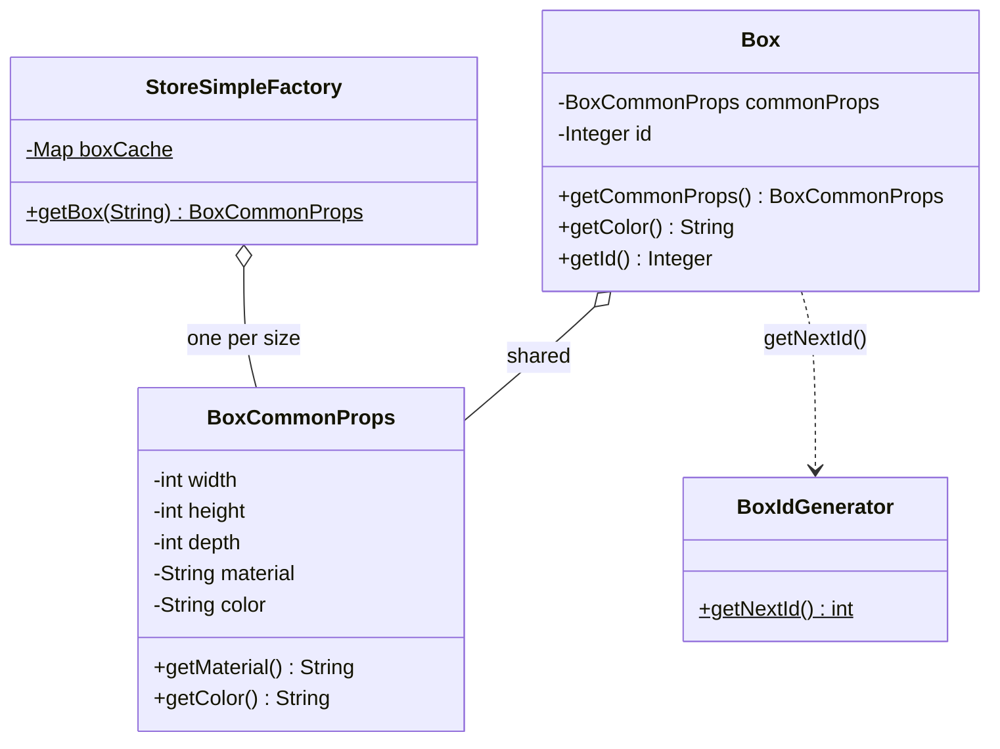

# Flyweight — Storehouse Boxes

**Week 5 · Structural**

## Intent
Use sharing to support large numbers of fine-grained objects efficiently. Split each object's state into *intrinsic* state, which is the same for many objects and is shared, and *extrinsic* state, which is unique per object and kept outside the shared part.

## The problem (`main`)
- Every `Box` stores its own `width`, `height`, `depth`, `material` and `color`, although the storehouse stocks only four kinds of box (`s`, `m`, `m-metal`, `l`).
- `StoreSimpleFactory.createBox(size)` builds a brand-new `Box` with those five values copied in on every call.
- The test orders 304 boxes, so the same four property sets are stored 304 times. Only the `id` really differs from box to box.

## The solution (`solution/flyweight-storehouse`)
- `BoxCommonProps` (Flyweight) holds the intrinsic state: size, material and color. Its fields are `private final`, so a shared instance can't be changed by one box behind the others' backs.
- `StoreSimpleFactory` (Flyweight Factory) creates the four `BoxCommonProps` once, in a static block, and `getBox(size)` returns the cached instance. An unknown size returns `null`.
- `Box` (Context) keeps only the extrinsic state, its `id` from `BoxIdGenerator`, plus a reference to the shared props (`getCommonProps()`).
- The test orders the same 304 boxes and asserts that they reference only 4 distinct props objects (`assertSame` for two boxes of one size), while every box still has its own id.

## Before

## After

## Compare
[problem/flyweight-storehouse...solution/flyweight-storehouse](https://github.com/vamekh/ug-design-patterns-2025/compare/problem/flyweight-storehouse...solution/flyweight-storehouse)

## Discussion
- The client now asks the factory for the shared props and calls `new Box(props)` itself. Another option keeps `createBox(size)` and has it wrap the cached props, so callers never see the flyweight.
- `getBox()` returning `null` for an unknown size defers the failure to the first `box.getColor()`. Throwing `IllegalArgumentException` would fail at the point of the mistake.
- The static `instanceCount` counters are there for the demo; they are global and keep growing across tests in one JVM.
- Compare with the [Forest game](https://github.com/vamekh/ug-design-patterns-2025/blob/solution/flyweight-forestgame/docs/flyweight-forestgame.md) example, which has the same split with a flyweight interface and per-tree extrinsic location.
